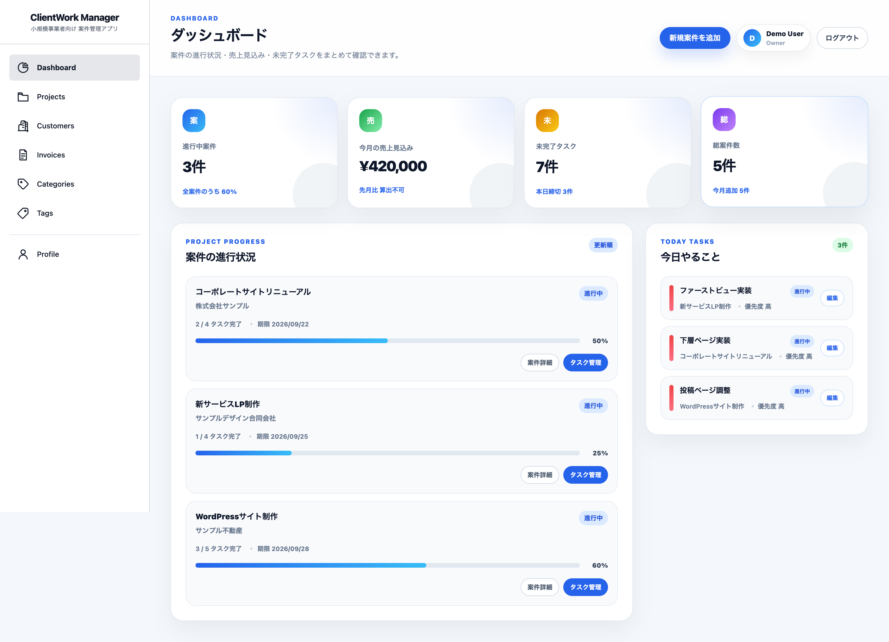
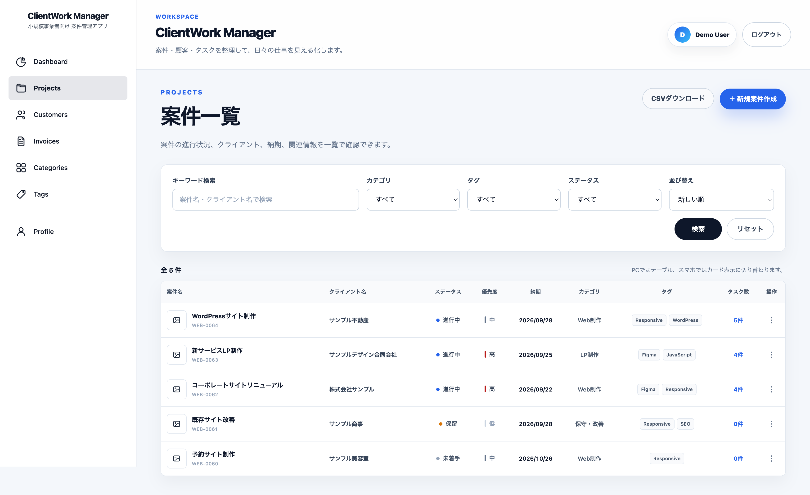
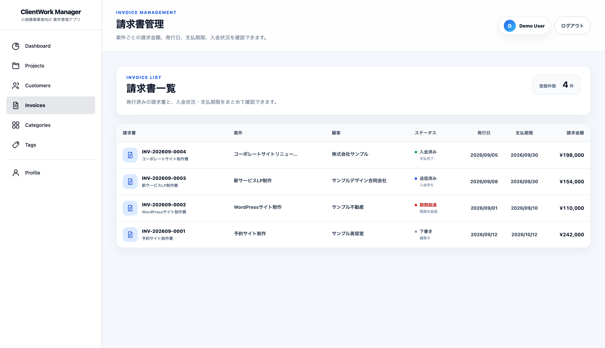
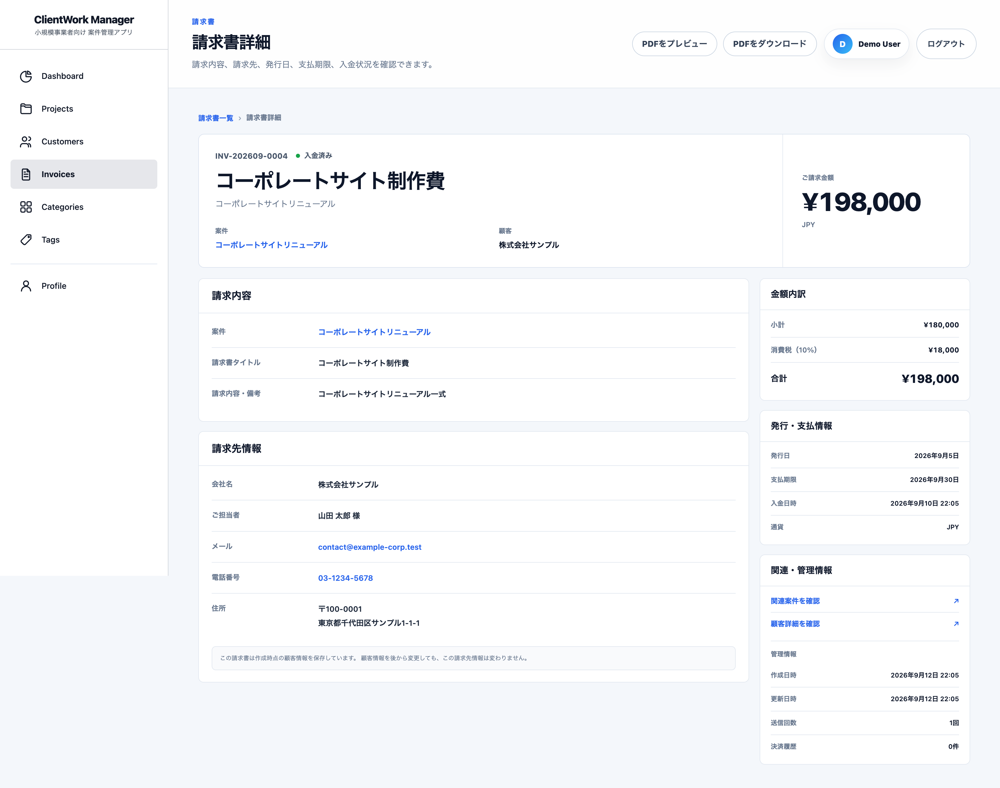

# ClientWork Manager

フリーランス・個人事業主・小規模事業者向けの案件管理Webアプリです。

案件・顧客・タスク・請求書・決済情報を一元管理し、
**案件の進行管理から請求書発行、オンライン決済、入金確認までを1つのアプリで完結できること**を目指して開発しました。

Laravelの基本的なCRUDに加えて、認証・認可、Eloquentリレーション、画像管理、CSV出力、期限通知、PDF生成、メール送信、Stripe決済、Webhook、API、自動テストなど、実務で必要になる処理を意識して実装しています。

> 画面内に表示している会社名・氏名・メールアドレス・金額などは、ポートフォリオ撮影用のデモデータです。

---

## 画面イメージ

### ダッシュボード

案件数、売上見込み、未完了タスク、本日締切のタスク、案件ごとの進捗状況をまとめて確認できます。



### 案件管理

案件名・クライアント名による検索に加え、カテゴリ・タグ・ステータスによる絞り込み、並び替え、タスク件数の確認、CSV出力に対応しています。



### 請求書管理

案件・顧客と紐づいた請求書を一覧で管理し、下書き・送信済み・入金済み・期限超過などの状態を確認できます。



### 請求書詳細

請求内容、請求先スナップショット、税額、支払期限、入金日時などを確認できます。PDFのプレビュー・ダウンロードにも対応しています。



---

## 開発背景

フリーランスや小規模事業者の業務では、案件情報、顧客情報、タスク、請求書、入金状況などが複数のサービスやファイルに分散しやすくなります。

ClientWork Managerでは、それらを1か所にまとめ、案件開始から入金確認までの業務を継続して管理できる構成にしました。

```text
顧客を登録
  ↓
案件を登録
  ↓
タスク・進捗を管理
  ↓
請求書を作成
  ↓
PDFを出力・メールで送信
  ↓
顧客が公開ページからStripeで支払い
  ↓
Stripe Webhookを受信
  ↓
Payment・Invoiceを同期
  ↓
管理画面で入金を確認
```

単に画面を作るだけではなく、**データの整合性、権限管理、二重処理の防止、エラー発生時の復旧しやすさ**まで考慮しています。

---

# 主な機能

## 認証・プロフィール

- Laravel Fortifyによるログイン・新規登録
- プロフィール情報の変更
- メールアドレス・パスワード変更
- 事業者プロフィールの管理
- 未ログインユーザーのアクセス制御
- Laravel SanctumによるAPIトークン認証

請求書で使用する事業者情報や振込先情報もプロフィール側で管理し、請求書発行時にスナップショットとして保存します。

---

## ダッシュボード

ログインユーザーの情報だけを対象に、現在の業務状況を確認できます。

- 総案件数
- 進行中案件数
- 進行中案件の割合
- 今月追加された案件数
- 今月の売上見込み
- 前月との売上見込み比較
- 未完了タスク数
- 本日締切のタスク
- 最近更新された案件
- 案件ごとのタスク進捗率

案件進捗の集計では `withCount()` を利用し、案件ごとに個別のCOUNTクエリを発行しないようにしています。

---

## 案件管理

- 案件の登録・一覧・詳細・編集・削除
- 案件名・クライアント名による検索
- カテゴリによる絞り込み
- タグによる絞り込み
- ステータスによる絞り込み
- 並び替え
- ページネーション
- 優先度管理
- 案件画像アップロード
- 顧客・カテゴリ・タグとの関連付け
- タスク件数表示
- タスク進捗率表示
- 案件名から詳細画面への遷移
- CSVエクスポート
- PC・スマートフォン対応

検索・絞り込み・並び替え処理はServiceへまとめ、一覧画面とCSV出力で検索条件がずれないようにしています。

---

## カテゴリ・タグ管理

### カテゴリ

- 登録
- 編集
- 削除
- 案件との1対多リレーション

### タグ

- 登録
- 編集
- 削除
- 1案件への複数タグ設定
- 中間テーブルによる多対多リレーション

Laravelでは以下の仕組みを利用しています。

```text
belongsTo
hasMany
belongsToMany
sync
whereHas
```

---

## タスク管理

案件ごとにタスクを登録し、進捗を管理できます。

### 主な機能

- タスクの登録・一覧・編集・削除
- ステータス管理
- 優先度管理
- 期限管理
- メモ管理
- 完了日時の記録
- 案件単位の進捗率計算
- CSVエクスポート
- 所有者チェック
- SortableJSによるドラッグ＆ドロップ並び替え

### ステータス

```text
未着手
進行中
完了
```

### 優先度

```text
低
中
高
```

タスクと案件の所有者が一致することを確認し、他ユーザーのデータを操作できないようにしています。

---

## 顧客・名刺管理

- 顧客の登録・一覧・詳細・編集・削除
- 会社名
- 担当者名
- メールアドレス
- 電話番号
- 郵便番号
- 住所
- メモ
- 名刺画像の表面・裏面管理
- 片面のみの登録
- 画像の差し替え
- 未変更画像の維持
- 顧客削除時の画像削除
- ファイル欠損時のフォールバック表示
- CSVエクスポート

### 対応画像

```text
JPG
JPEG
PNG
WebP

最大5MB
```

画像はLaravel Storageの `public` ディスクへ保存し、DBにはファイルそのものではなく相対パスを保存します。

```text
DB:
customers/business-cards/xxxxxxxx.webp

Storage:
storage/app/public/customers/business-cards/
```

---

# 請求書機能

## 請求書管理

案件・顧客と紐づけて請求書を管理できます。

- 請求書の作成・一覧・詳細・編集・削除
- 案件との関連付け
- 顧客との関連付け
- ユーザー・年月単位の請求書番号採番
- 請求先情報のスナップショット保存
- 発行者情報のスナップショット保存
- 取引日・税率・端数処理方法の保存
- 小計・消費税・合計金額のサーバー側計算
- 発行日管理
- 支払期限管理
- 送信日時管理
- 入金日時管理
- 送信回数管理
- 決済履歴件数表示

### ステータス

```text
draft       下書き
sent        送信済み
paid        入金済み
overdue     期限超過
canceled    キャンセル
```

請求書の小計はリクエストから受け取りますが、消費税額と合計金額はブラウザ側の計算結果を信用せず、サーバー側で再計算します。

### スナップショット

請求書には、作成・更新時点の請求先情報と発行者情報を保存します。

そのため、後から顧客情報や事業者プロフィールを変更しても、すでに発行した請求書の情報が意図せず変化しません。

### 編集・削除制御

編集・削除できるのは原則として下書きだけです。

さらに、決済履歴が1件でも存在する請求書は、下書きであっても削除できません。

決済履歴との対応関係を残し、監査性を保つための制御です。

---

## 請求書PDF

- PDFプレビュー
- PDFダウンロード
- A4縦レイアウト
- 日本語フォント対応
- 請求元情報
- 請求先情報
- 小計
- 消費税
- 合計金額
- 発行日
- 支払期限
- 振込先情報

PDF生成処理はControllerへ直接記述せず、Serviceへ分離しています。

また、管理画面のBladeとは別にPDF専用Bladeを使用し、ブラウザ表示と帳票表示を分離しています。

---

## 請求書メール

- メール作成画面
- 宛先入力
- CC・BCC
- 件名・本文編集
- PDF添付
- Mailpitによるローカル受信確認
- 送信日時の記録
- 送信回数の記録
- 最終送信先の記録
- 送信後のステータス更新
- オンライン支払いページへのリンク掲載
- 送信失敗時のエラーハンドリング

メール送信処理とPDF生成処理は、Controllerから分離しています。

---

# 顧客向けオンライン支払い

ログインしていない顧客でも、請求書メールなどから公開支払いページを開き、Stripeで支払えます。

## 支払いフロー

```text
事業者が請求書を作成
  ↓
請求書をメール送信
  ↓
顧客が公開支払いURLを開く
  ↓
Stripe Payment Elementへカード情報を入力
  ↓
PaymentIntentを処理
  ↓
Stripe Webhookを受信
  ↓
Laravel側でStripeの最新状態を取得
  ↓
Paymentを更新
  ↓
Invoiceをpaidへ更新
  ↓
管理画面で入金を確認
```

---

## 公開URL

```text
GET  /invoice-payments/{publicToken}
POST /invoice-payments/{publicToken}
GET  /invoice-payments/{publicToken}/result
```

公開URLには連番のInvoice IDを使用せず、推測しにくいUUID形式の `public_token` を使用します。

```text
例:
invoice-payments/d5d42616-e96e-442c-9085-a37fc14783aa
```

---

## 請求書状態ごとの公開画面

| ステータス | 公開画面       |
| ---------- | -------------- |
| `draft`    | 404            |
| `sent`     | 支払い可能     |
| `overdue`  | 支払い可能     |
| `paid`     | 支払い済み表示 |
| `canceled` | キャンセル表示 |

---

## 公開決済のセキュリティ

- 公開URLへInvoice ID・Payment IDを露出しない
- `public_token` にunique制約
- PaymentIntentの金額をブラウザから受け取らない
- PaymentIntentの通貨をブラウザから受け取らない
- Invoiceに保存された金額・通貨を使用
- `client_secret` をログへ出力しない
- 管理画面への導線を公開画面へ表示しない
- 決済開始エンドポイントへレート制限
- キャッシュ防止ヘッダー
- 検索エンジンのインデックス防止
- ブラウザの完了画面だけでは `paid` にしない

公開画面には以下のレスポンスヘッダーを設定しています。

```text
Cache-Control: no-store, private, max-age=0
Pragma: no-cache
X-Robots-Tag: noindex, nofollow, noarchive
```

---

# Stripe決済・Webhook

## PaymentIntent

- Stripe Payment Element
- PaymentIntentの作成
- PaymentIntentの取得
- PaymentIntentの確定
- 進行中PaymentIntentの再利用
- キャンセル済みPaymentIntentからの再作成
- PaymentとInvoiceの関連付け
- 冪等性キーによる二重作成防止
- 金額・通貨・所有者・案件の整合性確認

---

## 対応Webhookイベント

```text
payment_intent.succeeded
payment_intent.payment_failed
payment_intent.processing
payment_intent.canceled
```

---

## Webhook処理

Webhookのpayloadだけを信用せず、署名検証後にStripe APIからPaymentIntentの最新状態を取得して同期します。

主な処理は以下です。

- `Stripe-Signature` の検証
- 生のリクエスト本文を使った署名検証
- 対象外イベントの安全な無視
- Stripe APIからPaymentIntentを再取得
- Paymentを行ロック
- Invoiceを行ロック
- PaymentとInvoiceを同一DBトランザクションで更新
- 例外発生時のロールバック
- 重複Webhookへの冪等対応
- `paid_at` の不用意な上書き防止
- 請求書と無関係な既存決済への影響防止

Invoiceを `paid` へ変更できるのは、整合性を確認できた場合だけです。

```text
Payment.status = succeeded

Invoice.status = sent または overdue

Payment.invoice_id = Invoice.id
Payment.user_id = Invoice.user_id
Payment.project_id = Invoice.project_id

Payment.amount = Invoice.total_amount
Payment.currency = Invoice.currency
```

`draft` や `canceled` の請求書に成功決済が紐づいた場合は、異常状態として扱い、自動的に `paid` へ変更しません。

---

# 決済API

Laravel SanctumによるAPIトークン認証を使用しています。

```text
POST /api/auth/token

POST /api/payments
POST /api/payments/{payment}/confirm

POST /api/webhooks/stripe
```

主な対策：

- APIトークン認証
- Token Abilityによる権限制御
- `Idempotency-Key` 必須
- Payment所有者の認可
- Stripe PaymentIntent IDのunique制約
- 冪等性キーのunique制約
- 他ユーザーのPayment操作を禁止
- Stripe APIエラーの変換
- Webhook署名検証

---

# CSVエクスポート

以下のCSV出力に対応しています。

```text
案件一覧
顧客一覧
案件単位のタスク一覧
```

実装上は以下を意識しています。

- ログインユーザーのデータのみ出力
- 検索・絞り込み条件を維持
- `StreamedResponse` によるストリーミング
- UTF-8 BOM
- `fputcsv()` の利用
- CSVインジェクション対策
- 電話番号・郵便番号の先頭0を維持

---

# タスク期限通知

期限が近い未完了タスクを、案件所有者へメール通知します。

## 通知タイミング

```text
期限7日前
期限3日前
期限前日
期限当日
期限超過
```

完了済みタスクと期限未設定タスクは通知対象外です。

---

## 処理構成

```text
Laravel Scheduler
  ↓
Artisan Command
  ↓
TaskDueNotificationService
  ↓
Laravel Notification
  ↓
SMTP / Mailpit
```

---

## 重複送信防止

通知履歴テーブルに、以下の組み合わせを記録します。

```text
task_id
+
due_date
+
notification_type
```

通知状態：

```text
pending
sent
failed
```

同一タスク・期限・通知種別の重複通知を防ぎつつ、期限が変更された場合は新しい通知として扱える設計です。

`failed` は再試行でき、古い `pending` も一定条件で再取得できるようにしています。

---

## 手動実行

```bash
./vendor/bin/sail artisan tasks:send-due-notifications --dry-run

./vendor/bin/sail artisan tasks:send-due-notifications

./vendor/bin/sail artisan tasks:send-due-notifications --date=2030-07-10
```

---

## Scheduler

日本時間の午前9時に毎日実行します。

```php
$schedule
    ->command('tasks:send-due-notifications')
    ->dailyAt('09:00')
    ->timezone('Asia/Tokyo')
    ->withoutOverlapping(60);
```

---

# 設計上の工夫

## 責務分離

Controllerへ処理を集中させないよう、役割ごとに分離しています。

```text
Controller
    リクエスト・レスポンス制御

FormRequest
    バリデーション

Policy
    認可

Service
    再利用する業務ロジック

Action
    特定ユースケースの実行

Model
    データ・リレーション
```

---

## データベース

- Eloquentリレーション
- `belongsTo`
- `hasMany`
- `belongsToMany`
- 中間テーブル
- 外部キー制約
- 複合unique制約
- `nullOnDelete()`
- DBトランザクション
- `lockForUpdate()`

アプリケーション側のチェックだけに依存せず、DB制約も利用して不整合を防いでいます。

---

## データ整合性

特に決済・請求書では、処理途中の失敗によって中途半端なデータが残らないことを重視しています。

例：

```text
Payment更新
+
Invoice更新
↓
同一DBトランザクションで実行
```

競合する可能性がある処理では、`lockForUpdate()` を使用しています。

---

## 画像更新

案件画像の更新では、

```text
新画像をStorageへ保存
  ↓
DBを更新
  ↓
成功後に旧画像を削除
```

という順番にしています。

DB更新に失敗した場合は新しく保存した画像を削除し、StorageとDBの不整合を残さないよう補償処理を行います。

---

## パフォーマンス

- Eager LoadingによるN+1問題対策
- `withCount()` による関連件数取得
- ページネーション
- CSVのストリーミング出力
- 必要なリレーションだけを事前読み込み
- 外部API通信とDBトランザクションの責務を分離

---

# セキュリティ

実装では以下を意識しています。

- FortifyによるWeb認証
- SanctumによるAPI認証
- Policyによる所有者認可
- FormRequestによる入力検証
- CSRF対策
- Stripe Webhook署名検証
- UUID公開トークン
- レート制限
- 他ユーザーのデータ混入防止
- ファイル形式・容量の検証
- CSVインジェクション対策
- Stripe Secret・Webhook SecretをGitへ保存しない
- `client_secret` をログへ出力しない
- 請求書の振込先口座番号を暗号化して保存

---

# レスポンシブ対応

## PC

- 白基調の固定サイドバー
- テーブル形式の一覧
- 情報量に応じた2カラムレイアウト
- 控えめな罫線・余白・シャドウ
- 青をアクセントにした操作UI

## スマートフォン

- モバイル用ヘッダー
- 下部固定ナビゲーション
- テーブルからカード表示へ切り替え
- フォーム・検索UIの縦配置
- タップ操作を考慮したボタンサイズ
- 画面幅に応じたレイアウト変更

一覧画面では、マウス操作だけでなくキーボード操作も考慮しています。

---

# 技術スタック

| 分類            | 技術                                             |
| --------------- | ------------------------------------------------ |
| Backend         | PHP 8.5 / Laravel 10.x                           |
| Development     | Laravel Sail / Docker Desktop                    |
| Database        | MySQL 8.4                                        |
| Database Tool   | phpMyAdmin                                       |
| Authentication  | Laravel Fortify / Laravel Sanctum                |
| Frontend        | Blade / HTML / CSS / JavaScript                  |
| Build Tool      | Vite 5                                           |
| Payment         | Stripe PaymentIntent / Payment Element / Webhook |
| Mail            | Laravel Mail / Notification / Mailpit            |
| PDF             | Dompdf / IPA日本語フォント                       |
| Drag & Drop     | SortableJS                                       |
| Test            | PHPUnit 10                                       |
| Code Style      | Laravel Pint                                     |
| Version Control | Git / GitHub                                     |

---

# セットアップ

## 必要環境

- Docker Desktop
- Git
- Composer

---

## インストール

```bash
git clone <repository-url>

cd portfolio-manager

composer install

cp .env.example .env

./vendor/bin/sail up -d

./vendor/bin/sail artisan key:generate

./vendor/bin/sail artisan migrate

./vendor/bin/sail artisan storage:link

./vendor/bin/sail npm install

./vendor/bin/sail npm run dev
```

---

## デモデータ

ポートフォリオ確認用のデモデータを作成できます。

```bash
./vendor/bin/sail artisan db:seed --class=DemoSeeder
```

デモデータには以下が含まれます。

- Demo User
- 顧客
- 案件
- カテゴリ
- タグ
- タスク
- 請求書

実在する顧客情報は使用していません。

---

## ローカルアクセス

```text
アプリ
http://localhost

Mailpit
http://localhost:8025
```

---

# 環境変数

## メール

```env
APP_URL=http://localhost
APP_TIMEZONE=Asia/Tokyo

MAIL_MAILER=smtp
MAIL_HOST=mailpit
MAIL_PORT=1025
MAIL_USERNAME=null
MAIL_PASSWORD=null
MAIL_ENCRYPTION=null

MAIL_FROM_ADDRESS=notifications@clientwork-manager.test
MAIL_FROM_NAME="${APP_NAME}"
```

---

## Stripe

Stripeのテスト用キーを設定します。

```env
STRIPE_KEY=pk_test_xxxxxxxxxxxxx
STRIPE_SECRET=sk_test_xxxxxxxxxxxxx
STRIPE_WEBHOOK_SECRET=whsec_xxxxxxxxxxxxx
```

実際のSecret KeyやWebhook SecretはGitへ登録しません。

---

# Stripe Webhookのローカル確認

Stripe CLIを使用して、ローカル環境へWebhookを転送します。

```bash
stripe login

stripe listen --forward-to http://localhost/api/webhooks/stripe
```

Stripe CLIに表示されたWebhook Secretを `.env` へ設定します。

```env
STRIPE_WEBHOOK_SECRET=whsec_xxxxxxxxxxxxx
```

設定変更後：

```bash
./vendor/bin/sail artisan config:clear
```

Stripeのテストカード例：

```text
カード番号
4242 4242 4242 4242

有効期限
将来の日付

CVC
任意の3桁
```

実際のカード情報は使用しません。

---

# Schedulerの確認

登録されているスケジュールを確認します。

```bash
./vendor/bin/sail artisan schedule:list
```

ローカルでSchedulerを実行する場合：

```bash
./vendor/bin/sail artisan schedule:work
```

---

# テスト

全テストを実行します。

```bash
./vendor/bin/sail artisan test
```

コード整形：

```bash
./vendor/bin/sail pint
```

主に以下をテストしています。

### 認証・認可

- 未ログインユーザーのアクセス制御
- 所有者本人のみ操作可能
- 他ユーザーのデータ操作防止
- Policy境界

### 案件・タスク

- CRUD
- 優先度
- 検索・絞り込み
- タスク進捗
- 期限通知
- 通知重複防止

### 請求書

- 作成
- 一覧
- 詳細
- 編集
- 更新
- 削除
- バリデーション
- Policy
- 請求書番号採番
- PDF生成
- メール送信

### オンライン決済

- 公開請求書ページ
- UUID形式チェック
- 存在しないトークン
- 下書き請求書の非公開
- 支払い済みの再決済防止
- キャンセル済みの再決済防止
- セキュリティヘッダー
- PaymentIntent作成
- PaymentIntent再利用
- 金額・通貨不一致
- Webhook署名検証
- Payment・Invoice同期
- `paid_at` の整合性
- 重複Webhook
- 異常状態の請求書への誤反映防止

Feature TestとUnit Testの両方を使用し、正常系だけでなく異常系・認可境界も確認しています。

---

# 主なディレクトリ

```text
app/
├── Actions/
│   └── Payment/            決済関連ユースケース
│
├── Console/
│   └── Commands/           Artisan Command
│
├── Contracts/              Interface
│
├── Http/
│   ├── Controllers/        Controller
│   └── Requests/           FormRequest
│
├── Mail/                   Mailable
├── Models/                 Eloquent Model
├── Notifications/          通知
├── Policies/               認可
└── Services/               業務ロジック

database/
├── factories/              テストデータ
├── migrations/             DB定義
└── seeders/                Seeder

resources/
├── css/                    ページ別CSS
├── js/                     JavaScript
└── views/
    ├── invoice-payments/   顧客向け公開決済画面
    ├── invoices/           請求書管理画面
    ├── mail/               メール
    └── payments/           決済画面

tests/
├── Fakes/                  Stripe Fake
├── Feature/                Feature Test
└── Unit/                   Unit Test
```

---

# 実務を意識したポイント

このアプリでは、「機能が動くこと」だけでなく、実務で問題になりやすい部分を意識して設計しています。

### 認可

マルチユーザー環境を前提とし、他ユーザーの案件・顧客・タスク・請求書・決済情報を操作できないようにしています。

### データ整合性

DBトランザクション、unique制約、外部キー、行ロックを組み合わせ、二重処理や不整合を防ぎます。

### Stripe

ブラウザ上で「決済完了」と表示されたことだけを根拠に入金済みへ変更せず、署名検証済みWebhookとStripe側の最新状態を基準に同期します。

### 請求書

発行時点の請求先・発行者情報をスナップショットとして保存し、元データ変更による過去請求書の変化を防ぎます。

### 保守性

Controllerへ業務ロジックを集中させず、FormRequest・Policy・Service・Actionへ責務を分離しています。

### テスト

正常系だけでなく、認可エラー・入力エラー・Stripe異常・重複Webhook・金額不一致などもテストしています。

---

# このポートフォリオで示せること

ClientWork Managerでは、単純なCRUDにとどまらず、以下の実装経験を示せます。

```text
Laravel MVC
認証
認可
FormRequest
Policy
Eloquentリレーション
検索・絞り込み
Eager Loading
withCount
N+1対策
画像アップロード
Storage
CSV
Scheduler
Notification
PDF
メール送信
Stripe
PaymentIntent
Webhook
Sanctum API
DBトランザクション
行ロック
冪等性
Feature Test
Unit Test
レスポンシブ対応
Git / GitHub
```

特に請求書から決済までの機能では、

```text
請求書作成
  ↓
PDF生成
  ↓
メール送信
  ↓
公開支払い
  ↓
Stripe決済
  ↓
Webhook
  ↓
入金状態同期
```

という、複数機能をまたぐ一連の業務フローを実装しています。

---

# 今後の改善

実運用を想定した場合、今後は以下を追加したいと考えています。

- Queueによるメール・通知の非同期処理
- 本番SMTPサービスへの切り替え
- 通知設定画面
- 通知履歴画面
- Stripe返金対応
- Stripe一部返金対応
- 決済履歴詳細画面
- 操作ログ・監査ログ
- 請求書帳票要件の追加改善
- CI/CD
- 本番環境へのデプロイ
- エラー監視・ログ監視

---

## 補足

本アプリはLaravel学習用の自主開発プロジェクトとして制作しています。

実在する企業・顧客の業務データは使用していません。
